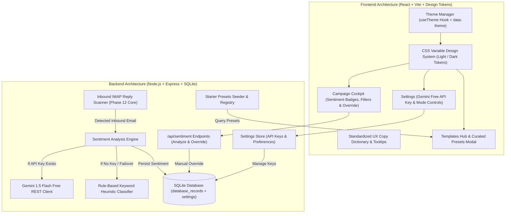

# Architecture Research: UI Overhaul, Light Mode & Free AI Reply Intelligence

**Milestone:** v3.0  
**Domain:** Local Cold Email Outreach & Privacy-First CRM  
**Date:** 2026-10-05  

---

## 1. System Architecture Overview

Milestone v3.0 integrates three architectural pillars into the existing StrokeCRM stack without breaking any existing dispatch queue or IMAP polling mechanisms:



---

## 2. Component Integration Details

### 1. Dual-Theme CSS Token Architecture
- **Root Declaration (`client/src/index.css`)**:
  - Dark Theme (`:root`, `[data-theme="dark"]`):
    - `--bg-canvas`: `#09090b` (zinc-950)
    - `--bg-surface`: `#18181b` (zinc-900)
    - `--bg-elevated`: `#27272a` (zinc-800)
    - `--border-subtle`: `rgba(255, 255, 255, 0.08)`
    - `--text-primary`: `#f4f4f5` (zinc-100)
    - `--text-secondary`: `#a1a1aa` (zinc-400)
    - `--text-muted`: `#71717a` (zinc-500)
  - Light Theme (`[data-theme="light"]`):
    - `--bg-canvas`: `#f8fafc` (slate-50)
    - `--bg-surface`: `#ffffff` (white)
    - `--bg-elevated`: `#f1f5f9` (slate-100)
    - `--border-subtle`: `rgba(0, 0, 0, 0.08)`
    - `--text-primary`: `#0f172a` (slate-900)
    - `--text-secondary`: `#475569` (slate-600)
    - `--text-muted`: `#94a3b8` (slate-400)
- **Theme Provider / Hook (`client/src/context/ThemeContext.jsx`)**:
  - Exposes `theme` (`'dark' | 'light'`) and `toggleTheme()`.
  - Sets `document.documentElement.setAttribute('data-theme', theme)` and stores in `localStorage.getItem('strokecrm_theme')`.

### 2. Inbound Sentiment Analysis Engine (`server/services/sentimentService.js`)
- **Pipeline Flow**:
  1. Triggered automatically in `server/services/replyScannerService.js` whenever a valid inbound lead email is parsed.
  2. Input sanitization: strips previous quoted history (`> On ... wrote:`, `-----Original Message-----`) so only the lead's new reply text is evaluated.
  3. API check:
     - If `gemini_api_key` is set in SQLite `settings`:
       - Dispatches POST request to `https://generativelanguage.googleapis.com/v1beta/models/gemini-1.5-flash:generateContent?key=${apiKey}` using global `fetch`.
       - Prompt provides strict classification instructions and requests `response_mime_type: "application/json"`.
     - If no key or API call throws (timeout, rate limit):
       - Automatically invokes `server/services/sentimentHeuristics.js`.
  4. Database Persistence:
     - Updates `database_records` atomically:
       ```sql
       UPDATE database_records 
       SET reply_sentiment = ?, 
           reply_confidence = ?, 
           reply_summary = ?, 
           reply_analyzed_at = CURRENT_TIMESTAMP
       WHERE id = ?
       ```

### 3. Starter Presets Registry (`server/services/starterPresets.js`)
- Static, vetted catalog of 4 high-converting cold outreach sequences:
  - *Direct Executive Pitch*
  - *Value-Add / Case Study Teaser*
  - *Gentle Cadence Follow-Up*
  - *Graceful Closing / Breakup*
- Endpoint `GET /api/templates/starter-presets` returns the catalog.
- Endpoint `POST /api/templates/from-preset/:presetId` clones a preset into the user's active templates table.

### 4. Database Schema Migrations (`server/database.js`)
- Add non-destructive column checks:
  ```javascript
  const recordColumns = db.prepare("PRAGMA table_info(database_records)").all();
  if (!recordColumns.some(c => c.name === 'reply_sentiment')) {
    db.prepare("ALTER TABLE database_records ADD COLUMN reply_sentiment TEXT").run();
    db.prepare("ALTER TABLE database_records ADD COLUMN reply_confidence REAL").run();
    db.prepare("ALTER TABLE database_records ADD COLUMN reply_summary TEXT").run();
    db.prepare("ALTER TABLE database_records ADD COLUMN reply_analyzed_at TEXT").run();
  }

  const settingsColumns = db.prepare("PRAGMA table_info(settings)").all();
  if (!settingsColumns.some(c => c.name === 'gemini_api_key')) {
    db.prepare("ALTER TABLE settings ADD COLUMN gemini_api_key TEXT").run();
    db.prepare("ALTER TABLE settings ADD COLUMN sentiment_auto_analyze INTEGER DEFAULT 1").run();
  }
  ```
